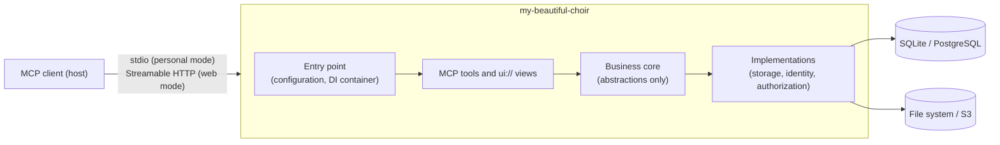

<!--
SPDX-FileCopyrightText: 2026 bobyone
SPDX-License-Identifier: GPL-2.0-or-later
-->

# Architecture

This document describes the architecture on three levels: overview,
abstractions and implementations. It is completed as each notion is
designed and implemented.

## Overview

my-beautiful-choir is an MCP server whose tools come with MCP Apps views
(`ui://` resources) rendered by the MCP client
([ADR 0002](decisions/0002-mcp-app-with-web-and-personal-modes.md)).

- **Entry point** (`cli.main`): reads the configuration once, configures
  the logs, assembles the application with `create_container(settings)` and
  runs it. It turns startup errors into a message and an exit code (see
  [troubleshooting](how-to/troubleshoot-startup.md)).
- **Assembly** (`containers`, `dependency-injector`): the only place where
  concrete implementations are chosen. `ApplicationContainer` holds the
  providers common to both modes; it receives, through a
  `DependenciesContainer` named `mode`, either `PersonalModeContainer` or
  `WebModeContainer`, which provide `metrics` and `transport`. Singletons
  are scoped to the container.
- **Business core**: tools and views (for now, `show_about`); repertoire and
  scores come next. It depends only on abstractions.
- **Implementations**: one set per mode, for identity, authorization
  ([ADR 0003](decisions/0003-multi-choir-tenancy-and-roles.md),
  [ADR 0004](decisions/0004-built-in-oauth-authorization-server.md)) and
  storage ([ADR 0005](decisions/0005-data-and-file-storage.md)).

## Notions

Each notion is a package of `src/my_beautiful_choir/`. Its general
abstraction sits at the root of the package; specializations and
implementations sit in sub-packages. Each notion defines its own exceptions
in `errors.py`; every exception derives from `MyBeautifulChoirError`.
Expected failures of an operation (element not found, invalid value) derive
from `DomainError`: their English message is returned to the model. Errors
preventing startup derive from `StartupError`, which carries a stable error
code and the process exit code.

## Abstractions

| Abstraction | Package | Role and contract |
|---|---|---|
| `Tool[ArgumentsT]` | `tools` | Operation offered to the MCP client, independent of the MCP SDK: `name`, `description` (English, for the model), `arguments_model` (pydantic model of the arguments, `NoArguments` when there is none; the MCP layer publishes its JSON Schema and validates the arguments), `view` (None by default), `async execute(arguments: ArgumentsT, context: ToolContext) -> ToolResult`; raises a `DomainError`. A tool asking for confirmation may run twice for one call (see `ElicitationConfirmation`): it changes nothing before asking. |
| `ViewTool[ArgumentsT](Tool)` | `tools.view_tool` | Tool displayed by a `View`. Template method: subclasses implement `_collect(arguments, context)` (data for the view) and `_describe(data)` (self-sufficient English text); `execute` returns both, so the text always matches the view. |
| `View` | `views` | User interface rendered by the client: `uri` (`ui://`), `content()` (self-contained HTML); raises `ViewNotFoundError`. |
| `ConfirmationRequester` | `confirmation` | `async ask(question) -> ConfirmationOutcome` (`confirmed`, `refused` or `unavailable` when the user cannot be asked); never raises because the user cannot be asked. |
| `Authorization` | `authorization` | `require(permission, choir_id=None)`: checks that the current user has a `Permission` (`manage_choirs`, `manage_repertoire`, `consult_repertoire`), in a choir when given ([ADR 0003](decisions/0003-multi-choir-tenancy-and-roles.md)); raises `AccessDeniedError`. |
| `Clock` | `clock` | `now() -> datetime`: current date and time, timezone-aware, in UTC. |
| `StartupStep` | `application` | `name`, `async run()`: something to do before serving; raises a `StartupError`. |
| `UnitOfWork` | `persistence` | One atomic operation on the data store, used as `async with`: changes are kept only by `commit()`; leaving without committing, or with an exception, discards them. Gives access to the repositories (`choirs`, `works`, `scores`). Services receive a `UnitOfWorkFactory` and open one unit of work per operation ([ADR 0012](decisions/0012-asynchronous-data-access.md)). |
| `ChoirRepository` | `choirs` | Stores the choirs within a unit of work: `add`, `get(id)` (raises `ChoirNotFoundError`), `find_by_name(name)` (ignoring case), `default()`, `list()` (the oldest first), `rename`, `make_default` (the previous default choir becomes ordinary), `delete`. |
| `WorkRepository` | `repertoire` | Stores the works within a unit of work: `add`, `get(id)` (raises `WorkNotFoundError`), `search(choir_id, text=None)` (title or composer containing the text, ignoring case and accents; unordered), `count_matching(choir_id, text=None)`, `search_page(choir_id, text, offset, limit)` (the same works ordered by title, then composer with no composer first, then id), `update`, `delete`, `count(choir_id)`. |
| `ScoreRepository` | `scores` | Stores the scores (not their content) within a unit of work: `add`, `get(id)` (raises `ScoreNotFoundError`), `list(work_id)` (by date added, then label), `delete`, `storage_keys_of_work(work_id)`, `storage_keys_of_choir(choir_id)`, `counts_of_works(work_ids)` (number of scores of each given work with scores). |
| `Deleter` | `deletion` | `deletion_target` (`DeletionTarget`), `describe_deletion(id) -> DeletionPreview` (summary and snapshot for confirmation), `delete(preview) -> Deletion` (checks permissions and removes the matching records and their stored contents). Implemented by `ChoirService` (choirs), `RepertoireService` (works) and `ScoreService` (scores). |
| `ScoreOpener` | `scores.opening` | `async open(score, content)`: shows a score to the user in the application that opens its format; raises `ScoreOpenError`. |
| `FileStorage` | `storage` | Keeps the content of files under keys made of segments separated by `/`, each of ASCII letters, digits, `-` or `_` (`choirs/<id>/scores/<id>`), checked by `check_storage_key` (raises `InvalidStorageKeyError`): `store(key, content)` (replaces atomically), `read(key)`, `delete(key)` (nothing if missing), `exists(key)`. Other failures raise `StorageError` ([ADR 0005](decisions/0005-data-and-file-storage.md)). |
| `ScoreFormatSignature` | `scores.formats` | `format`, `matches(content) -> bool`: recognizes one score format from the bytes of a file, never from its name; never decompresses an archive nor parses XML. `ZipArchiveSignature` (`signatures.zip`) specializes it for zip archives: it reads only the archive index and calls `matches_entries(names)`. |
| `ScoreFormatDetector` | `scores.formats` | `detect(content) -> ScoreFormat`: tries its signatures in order and gives the format of the first one that matches; raises `UnsupportedScoreFormatError`, listing the accepted formats. |
| `ScoreSource` | `scores.sources` | `origin` (`ScoreOrigin`) and `link` (`None` by default), recorded with the score; `async fetch(limit) -> ScoreContent`: gives the content of a score being added and its original file name, of at most `limit` bytes; stops as soon as the content exceeds the limit and raises `InvalidScoreSizeError`; raises a `ScoreSourceError` when the content cannot be obtained. An empty content is returned as is: the score service refuses it. One source is built per request, from the tool arguments. |
| `Metrics` | `monitoring` | `record_tool_call(tool_name, duration_seconds, failed)`, `record_http_request(method, route, status_code, duration_seconds)`, `export() -> MetricsExport`. |
| `HealthCheck` | `monitoring` | `status() -> HealthStatus` (`ready` or `unavailable`). |
| `Transport` | `transport` | `async run(server)`: serves an MCP SDK server until the client disconnects or a stop signal; raises a `StartupError` when it cannot start. |

Value objects: `Choir` (`choirs`: `id`, `name`, `created_at`, `is_default`),
`Work`, `WorkDetails` and `WorkChanges` (`repertoire`),
`Deletion` (`deletion`: `target`, `target_id`, `name`, `parent_name` (the choir
of a work, the work of a score), `work_count`, `score_count`), `DeletionTarget`
(`deletion`: `choir`, `work`, `score`),
`Score` (`scores`: `id`, `work_id`, `label`, `format`, `size`, `original_name`,
`origin`, `link`, `storage_key`, `added_at`), `ScoreOrigin` (`scores`:
`file_picker`, `local_file`, `google_drive`),
`GoogleDriveLink` (`scores.sources.google_drive`: `file_id`, `resource_key`;
`parse(link)` accepts `https://drive.google.com/file/d/<id>/...`, `/open?id=`
and `/uc?id=` and raises `UnsupportedLinkError` otherwise; `url`, the
canonical sharing link kept with the score; `download_url`),
`ScoreContent` (`scores.sources`: `original_name`, metadata only and never
used as a path, `content`, `size`), `ScoreFormat` (`scores.formats`: `pdf`, `musicxml`, `mxl`, `mscz`, with
`display_name`, `extension` and `media_type`: `application/pdf`,
`application/vnd.recordare.musicxml+xml`, `application/vnd.recordare.musicxml`
and the unregistered `application/x-musescore`),
`Settings` and `WebSettings` (`configuration`, immutable),
`ApplicationInfo` (`application`: name, version, mode), `ToolResult`
(`tools`: `text`, `structured`, `files`), `ToolFile` (`tools`: `name`,
metadata only and never a path, `media_type`, `content`, kept out of its
representation so it never reaches a log), `ToolContext` (`tools`:
`confirmation`; what a tool can use during one call), `MetricsExport` (`monitoring`).

## Implementations

### `cli.main(argv=None) -> int`

Exit codes: 0 normal stop (including Ctrl+C), 1 unexpected error
(`MBC-UNEXPECTED`), 2 invalid configuration or usage (`MBC-CONFIG`), 3
unavailable resource (`MBC-PORT`), 4 incomplete installation
(`MBC-INSTALL`), 5 unusable data store (`MBC-DATA`). Installed as the `my-beautiful-choir` command, and run by
`python -m my_beautiful_choir`.

### Containers (`containers`)

| Container | Provides | Depends on |
|---|---|---|
| `ApplicationContainer` | `application_info`, `views_directory`, `about_view`, `show_about_tool` (metered), `tools` (common tools, then the `mode_tools`), `server_builder`, `application` | `settings`, `mode` |
| `PersonalModeContainer` | `metrics` (`NullMetrics`), `transport` (`StdioTransport`), `database` (`SqlDatabase` in `MBC_DATA_DIR`), `file_storage` (`LocalFileStorage` in `MBC_DATA_DIR`), `score_format_detector` (the four signatures, MuseScore before compressed MusicXML), `startup_steps` (`PrepareDataStore`), `clock` (`SystemClock`), `authorization` (`LocalUserAuthorization`), `choir_service`, `repertoire_service`, `score_opener` (`SystemScoreOpener` in the temporary directory of the system), `google_drive_source` (a new `GoogleDriveScoreSource` per link), `score_service`, `mode_tools` (the choir, work and score tools, metered) | `settings` |
| `WebModeContainer` | `metrics` (`PrometheusMetrics`), `health_check` (`ServerHealthCheck`), `transport` (`HttpTransport`), `startup_steps` (none), `mode_tools` (none: the repertoire needs accounts) | `settings` |

`create_container(settings)` picks the mode container from `settings.mode`.
Tests replace a provider with `override()`, for instance
`container.mode.transport.override(...)`.

### `Application` (`application`)

`run()` builds the MCP server (failing at startup if a view is missing),
runs the startup steps in order, then serves with the transport until it
stops. Depends on `ApplicationInfo`, `McpServerBuilder`, `Transport` and a
sequence of `StartupStep` (none by default).

### `SqlDatabase` (`persistence.sql`)

| Parameter | Type | Description |
|---|---|---|
| `url` | SQLAlchemy `URL` | Database to reach with an async driver. `SqlDatabase.in_directory(data_dir)` gives the SQLite file `my-beautiful-choir.sqlite3` of personal mode (`aiosqlite`). |

- `unit_of_work()` returns a `SqlUnitOfWork`: one connection and one
  transaction, shared by the repositories; `commit()` commits and begins a
  new transaction.
- `migrate(revision="head")`, `downgrade(revision)` and
  `current_revision()` run the Alembic migrations of
  `persistence/sql/migrations/` on the database; there is no `alembic.ini`.
- No connection pool: no connection, hence no `aiosqlite` thread, outlives
  its unit of work. SQLite enforces foreign keys (`PRAGMA foreign_keys=ON`).
- Schema (`tables.py`): `choirs`, `works` and `scores`, with UUID keys,
  dates in UTC (`UtcDateTime`, which refuses naive dates and restores the
  timezone that SQLite drops) and a partial unique index allowing a single
  default choir. Every change of the schema comes with a migration; a test
  checks that the migrations produce exactly the schema of `tables.py`.

### `PrepareDataStore` (`persistence.sql`)

| Parameter | Type | Description |
|---|---|---|
| `data_dir` | `Path` | Data directory (`MBC_DATA_DIR`). |
| `database` | `SqlDatabase` | Database to migrate. |

Startup step of personal mode: creates the data directory, checks that it
can be written, then migrates the database. Raises `DataStoreError`
(`MBC-DATA`, exit code 5) when the directory cannot be used or the
migration fails.

### `LocalFileStorage` (`storage.file_system`)

| Parameter | Type | Description |
|---|---|---|
| `root` | `Path` | Directory holding the stored files. `LocalFileStorage.in_directory(data_dir)` gives the `files` subdirectory of the data directory, in personal mode. |

Each key is a file under `root`; its segments are subdirectories, created
when needed. Writing goes through a temporary file in the same directory,
then a rename, so that a stored file is never left half written. File
system calls run in a worker thread. A read with a maximum size reads at
most that size plus one byte. An `OSError` becomes a `StorageError`
naming the key. Limits: the whole content is held in memory (scores are at
most 50 MB); no locking between processes.

### `load_settings(argv)` (`configuration.loader`)

Parses the command line (`--mode`, `--version`, `--help`), reads the `MBC_`
environment variables and returns validated, immutable `Settings`. Raises
`ConfigurationError` (`MBC-CONFIG`, exit code 2) listing every invalid key.
Only the entry point calls it. See the [configuration reference](configuration.md).

### `ChoirService` (`choirs`)

| Parameter | Type | Description |
|---|---|---|
| `unit_of_work` | `UnitOfWorkFactory` | One unit of work per operation. |
| `clock` | `Clock` | Creation dates. |
| `authorization` | `Authorization` | `consult_repertoire` to list, `manage_choirs` to change. |
| `file_storage` | `FileStorage` | Stored contents of the scores, removed with a choir. |

- `list_choirs()`: every choir, the oldest first.
- `create(name)`: the name is trimmed and normalized (Unicode NFC), from 1 to
  100 characters (`InvalidChoirNameError`), unique ignoring case
  (`ChoirNameTakenError`); the first choir becomes the default choir.
- `rename(choir, new_name)`: same rules; only the case may change.
- `set_default(choir)`: the previous default choir becomes ordinary.
- `find_choir(choirs, name)`: the choir named `name`
  (`ChoirNotFoundError`), or the default choir when `name` is None
  (`NoChoirError` when there is no choir). Used by every operation taking
  an optional choir.

Deletion (`Deleter`, receives the `file_storage`): `delete(preview)` removes the
choir, its works and scores, then their stored contents; when the default
choir is deleted and choirs remain, the oldest one becomes the default
choir. `get_choir(name)` finds a choir by name, to delete it by id.

### Removal of stored contents (`deletion.stored_contents`)

`remove_stored_contents(file_storage, keys)`: called once the scores are
deleted (or not saved). Data is deleted first, contents second: a content
that cannot be deleted is logged (`A stored content could not be deleted
and is left`, with its key) and left as wasted space, never a score without
content.

### `SqlChoirRepository` (`choirs.sql`)

Table `choirs`; names are compared on `name_key` (trimmed, NFC, case-folded,
unique); a partial unique index allows a single default choir, so
`make_default` clears the previous one first.

### Choir tools (`tools.choirs`)

Text tools, without view: `list_choirs` (no argument), `create_choir(name)`,
`rename_choir(choir, new_name)`, `set_default_choir(choir)`. Choirs are
named by their name, ignoring case. The structured content describes the
choirs (`name`, `is_default`).

### `RepertoireService` (`repertoire`)

Same parameters as `ChoirService` (the `file_storage` holds the contents removed
with a work); `manage_repertoire` to change,
`consult_repertoire` to read.

- `add_work(choir, details)`: adds a work to the named choir, or the default
  choir. Rules (`work_rules.py`, `InvalidWorkError` naming the attribute):
  title required, at most 200 characters; composer and arranger 200;
  voicing 50; notes 2000; at most 10 sung languages, BCP 47 codes put in
  canonical case (`sr-Latn`, `pt-BR`), duplicates removed; texts trimmed,
  NFC, empty values dropped.
- `edit_work(work_id, changes)`: `None` keeps an attribute, an empty value
  clears it; updates the modification date.
- `get_work(work_id)`, `search(choir, text=None)`.
- `search_page_with_score_counts(choir, text, request)`: one repertoire page
  (`RepertoirePage`: choir, works, score counts, number, size, work count,
  page count) read in one snapshot. `PageRequest(number=1, size=10)` raises
  `InvalidRepertoirePageError` for a number below 1 or a size outside 1 to
  100 (`DEFAULT_PAGE_SIZE`, `MAXIMUM_PAGE_SIZE`). A number past the last page
  returns the last page; an empty search has one empty page.
- Deletion (`Deleter`, receives the `file_storage`): a work with its scores
  and their stored contents.

### `SqlWorkRepository` (`repertoire.sql`)

Table `works`; `title_search` and `composer_search` hold the case-folded
text without accents (`search_text`), computed on every write; searching
uses `LIKE` on them with `%` and `_` escaped. Repertoire pages are ordered
on the same columns with `OFFSET` and `LIMIT` (ADR 0018).

### Work tools (`tools.repertoire`)

Text tools: `add_work(choir?, title, composer?, arranger?, voicing?,
sung_languages?, notes?)` and `edit_work(work_id, ...)`. Works are named by
their id. The structured content describes the work (`work_data`).

### `ScoreService` (`scores`)

| Parameter | Type | Default | Description |
|---|---|---|---|
| `unit_of_work` | `UnitOfWorkFactory` | required | One unit of work per operation. |
| `clock` | `Clock` | required | Date added. |
| `authorization` | `Authorization` | required | `manage_repertoire` to add, `consult_repertoire` to list, read and open. |
| `file_storage` | `FileStorage` | required | Content of the scores. |
| `format_detector` | `ScoreFormatDetector` | required | Format recognized from the content. |
| `opener` | `ScoreOpener` | required | Opens the scores. |
| `maximum_size` | `int` | 50 MB | Largest content accepted, in bytes. |

- `add_score(work_id, source, label=None)`: checks the work and the right,
  then fetches the content outside any transaction (a download may be long);
  refuses an empty content (`InvalidScoreSizeError`), then recognizes the
  format. Rules (`score_rules.py`): label trimmed, NFC, without control
  characters, at most 100 characters (`InvalidScoreError`); by default the
  original name without its extension, or the format name; original name at
  most 255 characters; storage key `choirs/<choir id>/scores/<score id>`.
  `download_name(original, label, format)` gives the file name proposed for
  a download: the original name without a trailing extension (the
  extension of a score format, whatever its case, such as `.musicxml`;
  otherwise a dot, a letter, then at most four letters or digits, and a
  score format extension that this reveals, so `Alto.pdf.bak` gives
  `Alto.pdf`), otherwise the label, with
  control characters and `<>:"/\|?*` replaced by `_`, leading and trailing
  dots and spaces removed, `_` put before a name Windows reserves (`CON`,
  `NUL`, `COM1`...), cut to 255 characters, then the extension of the
  detected format; `score` when nothing is left.
  The content is stored, then the score saved; if saving fails (the work
  was deleted meanwhile, for instance), the stored content is removed, and
  a failed removal is logged.
- `list_scores(work_id)`.
- `read_score(score_id) -> (Work, Score, bytes)`: checks the right on the
  work's choir; raises `ScoreFileMissingError` when the content is missing
  from the storage; returns the content exactly as stored. It changes
  nothing.
- `open_score(score_id)`: reads the score with `read_score`, then gives the
  content to the opener.
- Deletion (`Deleter`): a score, then its stored content.

### `SqlScoreRepository` (`scores.sql`)

Table `scores`; the work's foreign key deletes its scores with it.

### `SystemScoreOpener` (`scores.opening.system`)

| Parameter | Type | Description |
|---|---|---|
| `directory` | `Path` or `None` | Directory of the temporary copies. `None`, used by `in_temporary_directory()`, creates a private directory under the system temporary directory on first use. |
| `launch` | `Callable[[Path], None]` | Opens a file with its default application: `os.startfile` on Windows, `open` on macOS, `xdg-open` elsewhere (`system_launcher(platform)`), with no access to the standard input, which is the MCP channel of personal mode. |

Writes a copy of the score in `<directory>/<score id>/<label><extension>`
(the label reduced to letters, digits, spaces, `-` and `_`, at most 100
characters), replaced at each opening, then launches it. The stored score
never changes: an edit in the application only changes the copy. Raises
`ScoreOpenError` when the copy cannot be written or the launch fails.
A replacement copy is written to a private file and then moved into place.
On POSIX the score directory is restricted to the owner even when reused.
On Windows its private parent controls access.

Limits: copies are left for the system to clean its temporary directory; a
launch that succeeds does not prove that an application showed the file.

### Score tools (`tools.scores`)

Text tools: `add_score_from_file(work_id, path, label?)`,
`add_score_from_google_drive(work_id, link, label?)` (receives a factory of
Google Drive sources), `open_score(score_id)` and `get_score_file(score_id)`.
Scores are named by their id. The structured content gives the `work_id` and
the score (`score_data`).

`GetScoreFileTool(service)` reads the score with `ScoreService.read_score` and returns it with
`score_file_result`: a text describing it and one `ToolFile` named by its
download name (`download_name`), with the media type of its format; the
structured content keeps the original name unchanged.

| Parameter | Type | Default | Description |
|---|---|---|---|
| `service` | `ScoreService` | required | Reads the score. |

There is no conversation limit: any stored score, up to the 50 MB score
maximum, is returned, and may enter the model context of hosts that pass
embedded resources to the model
([ADR 0020](decisions/0020-return-score-files-without-a-conversation-limit.md)).

### Score format signatures (`scores.formats.signatures`)

No parameter. The detector of personal mode tries them in this order:

| Signature | Format | Recognized when |
|---|---|---|
| `PdfSignature` | `pdf` | `%PDF-` appears within the first 1024 bytes. |
| `zip.MuseScoreSignature` | `mscz` | Zip archive with an entry ending in `.mscx` (any case). |
| `zip.CompressedMusicXmlSignature` | `mxl` | Zip archive with `META-INF/container.xml`, an entry ending in `.musicxml` or `.xml` outside `META-INF/`, and no `.mscx` entry. MuseScore files also hold a container: the `.mscx` entry tells them apart. |
| `MusicXmlSignature` | `musicxml` | Within the first 16 KiB, read as UTF-8 (or UTF-16 after a byte order mark), the root element, after the XML declaration, processing instructions, comments and document type, is `score-partwise` or `score-timewise`. |

Limits: a MusicXML file whose prolog exceeds 16 KiB, or in UTF-16 without
byte order mark, is not recognized. A zip signature only reads the index of
the archive (`zipfile.ZipFile.namelist`): no zip bomb; the MusicXML
signature never parses XML: no external entity.

### `UploadedScoreSource` (`scores.sources`)

| Parameter | Type | Description |
|---|---|---|
| `file_name` | `str` | Name of the file the user chose with the file picker of a view. |
| `content` | `bytes` | Content already received from the view. |

Gives the received content; raises `InvalidScoreSizeError` when it exceeds
the limit.

### `LocalFileScoreSource` (`scores.sources`)

| Parameter | Type | Description |
|---|---|---|
| `path` | `Path` | Absolute path of a file of the user's computer; a leading `~` is the user's home directory. |

Reads at most `limit + 1` bytes of the file, in a worker thread. Raises
`UnreadableLocalFileError` (with the path and the reason) when the path is
not absolute, the home directory is unknown, the path is not a regular file
(a directory, a device or a pipe is never read) or reading fails; raises
`InvalidScoreSizeError` beyond the limit. The path may come from the model:
the score service refuses any content that is not a score.

### `GoogleDriveScoreSource` (`scores.sources.google_drive`)

| Parameter | Type | Default | Description |
|---|---|---|---|
| `link` | `GoogleDriveLink` | required | File to download. |
| `transport` | `httpx.AsyncBaseTransport` or `None` | `None` (network) | HTTP transport; the tests give a mocked one. |
| `timeout_seconds` | `float` | `30.0` | Time limit of each network operation. |

Downloads `https://drive.usercontent.google.com/download?id=<id>&export=download&confirm=t`
(`confirm=t` skips the virus scan warning page of large files). Redirects
are followed one by one, at most 5: each must be HTTPS, without user
information, on port 443, to `drive.google.com`, `drive.usercontent.google.com`
or a `*.googleusercontent.com` host; a redirect to `accounts.google.com` (the
sign-in page) raises `NotPubliclyAccessibleError`, any other one
`DownloadFailedError`. Statuses 401, 403 and 404, and a web page (`text/html`)
instead of the file, raise `NotPubliclyAccessibleError`; another status, a
timeout or a network failure, `DownloadFailedError`. The content is requested
uncompressed (`Accept-Encoding: identity`) and read raw, never decompressed;
a declared length over the limit, or the content as soon as it exceeds the
limit, raises `InvalidScoreSizeError`. The original name comes from
`Content-Disposition` (the UTF-8 form first), reduced to its last segment,
without control characters, at most 255 characters; `Google Drive file`
otherwise.

Limits: the download address is not a documented API of Google; files too
large for Google's virus scan, or over their download quota, may be refused
as not publicly accessible.

### `ShowAboutTool` (`tools.view_tool.about`)

`show_about`: no argument; returns the name, version and mode of the
application (`{"name", "version", "mode"}`) and the text
`"<name> <version>, <mode> mode."`. Depends on `ApplicationInfo` and its view.

### `MeteredTool` (`tools`)

Decorator of any `Tool`: delegates name, description, arguments model and view, and
records each call (duration, failure when an exception is raised) in the
injected `Metrics`. Exceptions are re-raised unchanged. A call suspended to
wait for the user (`ToolCallSuspended`) is not recorded: the retry is.

### `ElicitationConfirmation` (`confirmation.mcp`)

| Parameter | Type | Description |
|---|---|---|
| `context` | SDK `Context` | Request context of the current tool call. |

Asks the user through the MCP client (form elicitation with one checkbox,
checked by default):

1. if the call carries the answer (a retry), returns `confirmed` when the
   form was accepted with the box checked, `refused` otherwise;
2. if the client does not support elicitation, returns `unavailable`;
3. from protocol 2026-07-28, raises `ConfirmationInputRequired`: the MCP
   layer ends the call with an input request, and the client retries it
   with the answer;
4. before, asks during the call; a client error gives `unavailable`.

**Limit:** the question is in English: the server does not know the
user's language.

### Repertoire and Work views (`tools.view_tool`, `ui/src/views`)

`ShowRepertoireTool(view, repertoire, choirs)` accepts the optional
`choir` name, optional `search` text, `page` (integer from 1, default 1)
and `page_size` (integer from 1 to 100, default 10). It returns one
repertoire page with `page`, `page_size`, `page_count` and `work_count`;
the model receives only the works of that page. It selects the default choir when
the name is omitted, returns the chooser's choir names and searches titles
and composers without accents or case. The repertoire service obtains
score counts of the works of the page, grouped by work, in one SQL query
within the same unit of work. A choir with no matches has an empty work
list. A new installation has no selected choir and the view explains how
to create one.

`ShowWorkTool(view, repertoire, scores)` accepts a required UUID
`work_id`. It returns work attributes and score metadata. The same Work
panel is used by the standalone Work view and when a user opens a work
in the Repertoire view. Returning from a work refreshes the same
repertoire page. The Repertoire view keeps the server order, shows the
number of matching works and, when there is more than one page, a
react-bootstrap pager (Previous, "Page n of N", Next) in a navigation
landmark; a new search or another choir returns to page 1. After a page
change, focus moves to the results heading (the number of matching works),
so the next Tab reaches the first work; returning from a work restores
focus to its button, or to the results heading if it is no longer listed. The UI sorts
choir names with the host language, displays sung languages by
their localized names and formats the score size with `Intl.NumberFormat`.

`UploadScoreTool(view, service, source_factory)` is app-only. Its
parameters are a work UUID, a non-empty file name of at most 255
characters, base64 file content and an optional label. It bounds the
encoded input to the base64 length of 50 MiB, checks the encoding, then
passes the bytes to `UploadedScoreSource` and the regular score service.
The service checks the decoded size and recognizes the format from the
content. The original name is metadata. The file storage key uses UUIDs.

`DownloadScoreTool(view, service)` is app-only: `download_score(score_id)`
reads the score with `ScoreService.read_score` and returns it with
`score_file_result`, with no limit other than the score maximum. When the host advertises the MCP Apps `downloadFile`
capability (`useHost().canDownload`), the Work panel shows **Download** next
to **Open** for each score: it calls `download_score`, takes the embedded
resource of the result and asks the host to save it with `App.downloadFile`
(`useHost().downloadFile`). The view shows the download in progress, then
"Score downloaded.", "Download cancelled." when the host answers `isError`
(a cancellation and a refusal look the same), or an error saying that the
score may have been deleted. Without the capability, the button is not
shown.

`PreviewDeletionFromWorkViewTool(view, deleter, pending)` registers
`preview_work_deletion` and `preview_score_deletion` with visibility
`["app"]` and a required UUID `target_id`. The Work panel loads the preview
before enabling its confirmation dialog. It confirms using
`confirm_deletion(token)`, like the Deletion view.

### `DeleteTool` and `ConfirmDeletionTool` (`tools.view_tool.deletion`)

The deletion tools describe what the user will delete before requesting
confirmation. The description includes the target, its parent when present,
and the number of works and scores affected. A refusal leaves the data intact.
When the client cannot ask directly, the tool stores the preview in
`PendingConfirmations[DeletionPreview]` and returns the Deletion view with
a token. MCP elicitation continuations use a separate registry of tokens
bound to the original tool call and preview.
The in-memory store issues single-use tokens valid for ten minutes and clears
expired entries when storing a new confirmation. Restarting the process
clears pending confirmations.

The view displays the description in the host language. The **Delete** button
sends the token to `confirm_deletion(token)`, advertised with MCP UI visibility
`["app"]`. **Cancel** changes the view state without requesting deletion.
The server consumes the token before calling the target's `Deleter`.
An expired or reused token returns `ConfirmationExpiredError`. If the
preview has changed, the deleter raises `StaleConfirmationError` with a
refreshed preview and the caller requests confirmation again. The SQLite
unit of work starts the verification and deletion transaction using
`BEGIN IMMEDIATE` before reading the current state. See ADR 0016.

### `PackagedView` (`views.packaged`)

| Parameter | Type | Description |
|---|---|---|
| `name` | `str` | File name without extension; the URI is `ui://my-beautiful-choir/<name>.html`. |
| `directory` | `Traversable` | Directory of the built views; `packaged_views_directory()` returns `my_beautiful_choir/views/static/` in the installed package. |

Reads `<name>.html` on first use and keeps it in memory. A missing file
raises `ViewNotFoundError` (`MBC-INSTALL`, exit code 4): the user interface
was not built (`uv run nox -s ui`) or the installation is broken.

### Personal-mode desktop installers (`scripts/installer`)

The two Python entry points compose the same installer with a
`ClientRegistration` for the selected client. The installer resolves uv,
checks Node.js and npm, syncs the lockfile, builds the interface and probes
the `Launcher` over MCP stdio with a temporary data directory. The launcher
records the absolute uv and checkout paths and starts personal mode without
synchronizing dependencies.

`ClaudeDesktopRegistration(config: Path)` atomically updates the named JSON
entry in the profile. `CodexDesktopRegistration(codex: Path)` uses the
Codex CLI to check and register the named MCP server. The client adapters
receive an approval callback. They call it before replacing a conflicting
registration. Failures are reported as `InstallationError`. See ADR 0017
and [the installation how-to](how-to/install-desktop-clients.md).

### `McpServerBuilder` (`mcp`)

Adapter between our tools and views and the MCP SDK (`MCPServer` and its
`Apps` extension). With the MCP adapters of other notions (`*/mcp/`), the
only code that imports the SDK.

| Parameter | Type | Description |
|---|---|---|
| `application_info` | `ApplicationInfo` | Name and version announced to the client. |
| `tools` | `Sequence[Tool]` | Tools to publish. |

`build()` returns a new `MCPServer`:

- a tool with a view is registered through MCP Apps (`_meta.ui.resourceUri`),
  and its view as a `ui://` resource (`text/html;profile=mcp-app`), once
  per URI; a tool without a view is a plain tool;
- the function registered for each tool gets a signature generated from the
  tool's arguments model (types, constraints, descriptions, defaults and
  default factories), so that the SDK publishes the JSON Schema and
  validates the arguments;
- arguments rejected by the model itself (for instance by a model
  validator) are returned to the model as an error result with the
  validation message;
- each call receives a `ToolContext` whose confirmation is an
  `ElicitationConfirmation` on the SDK request context, passed through a
  reserved parameter (`mbc_request_context`, refused as an argument name);
- a `ConfirmationInputRequired` ends the call with its input request;
- a `DomainError` is returned to the model as an error result with its
  message; any other exception is logged with its stack trace and
  returned as a generic error, without technical details;
- a missing view raises `ViewNotFoundError` during the build, hence at
  startup.
- each `ToolFile` of a result follows its text as an `EmbeddedResource`
  holding a `BlobResourceContents`: `uri` `file:///<name>` with every
  reserved character percent-encoded, `/` and `\` included, so the name
  stays the last segment, where hosts take the file name from; the media
  type; the content in base64 (see
  [ADR 0019](decisions/0019-return-score-files-as-embedded-resources.md)).

### `StdioTransport` (`transport.stdio`)

Serves MCP on stdin and stdout until stdin is closed. No parameter.

### `HttpTransport` (`transport.http`)

| Parameter | Type | Description |
|---|---|---|
| `settings` | `WebSettings` | Listening address, port and allowed hosts. |
| `metrics` | `Metrics` | Receives the HTTP request measures; exported on `/metrics`. |
| `health_check` | `ServerHealthCheck` | Marked ready once listening, unavailable when stopping. |

Routes: `/mcp` (Streamable HTTP, stateful sessions in memory), `/healthz`
(200 `{"status": "ready"}`, or 503 `{"status": "unavailable"}`), `/metrics`.

- **DNS rebinding protection** is always on: the `Host` header must be a
  local host (`127.0.0.1`, `localhost`, `[::1]`, any port) or one of
  `MBC_WEB__ALLOWED_HOSTS`; otherwise `/mcp` answers 421.
- **Correlation id**: `X-Request-ID` is reused when it is a valid UUID,
  generated otherwise, returned in the response and added to every log
  record of the request.
- **Request log**: one record per request with method, route, status and
  duration; never the client address. Unknown paths are grouped under the
  `other` route.
- The listening socket is opened before uvicorn starts: an address in use
  raises `PortUnavailableError` (`MBC-PORT`, exit code 3).
- `request_stop()` stops the server gracefully, like a stop signal. A
  SIGTERM (`docker stop`) stops it gracefully too, and the process then exits
  with code 0; uvicorn would otherwise raise SIGTERM again after the shutdown.
- **Limit**: no authentication yet; web mode must not be exposed publicly
  until OAuth is implemented.

### User interface (`ui/`)

Each view is a React application built by Vite into one self-contained HTML
file (`vite-plugin-singlefile`): MCP hosts render it in a sandboxed iframe
that forbids remote resources. Views are copied into
`my_beautiful_choir/views/static/` and served by `PackagedView`.

| Module | Role |
|---|---|
| `src/host/useHost.ts` | Connects the view to the host (`useApp`), keeps the tool result and the host context (merged with its changes), applies the host styles (`useHostStyles`). |
| `src/i18n/catalogues.ts` | Loads every catalogue of `ui/locales/` and the fallbacks of `ui/i18n/fallbacks.json`. |
| `src/i18n/resolveLanguage.ts` | Chooses the catalogue for the host locale: full tag, language and script, language, each with its fallback; English otherwise. |
| `src/i18n/i18n.ts` | Creates the i18next instance with ICU messages and English as fallback. |
| `src/theme/applyTheme.ts` | Applies the host theme to Bootstrap (`data-bs-theme`), light by default. |
| `src/views/about/` | The "About" view: `AboutApp` (host, language, theme), `AboutView` (loading, error, connection error, information), `parseAboutInfo` (validates the `show_about` structured content). |

Every user-facing text goes through a translation key; labels of glossary
terms use the `glossary.*` keys. See
[how to add a language](how-to/add-a-language.md) and
[how to build the user interface](how-to/build-the-ui.md).

### `LocalUserAuthorization` (`authorization.local`)

Personal mode: the implicit user manages every choir, so every permission
is granted. No parameter.

### `SystemClock` (`clock`)

Reads the system clock, in UTC. No parameter.

### `NullMetrics` (`monitoring`)

Null Object used in personal mode: records nothing, exports an empty body.

### `PrometheusMetrics` (`monitoring.prometheus`)

| Parameter | Type | Default | Description |
|---|---|---|---|
| `registry` | `CollectorRegistry \| None` | new registry | Prometheus registry holding the series. |

Series: `mbc_tool_calls_total{tool, outcome}`,
`mbc_tool_call_duration_seconds{tool}`,
`mbc_http_requests_total{method, route, status}`,
`mbc_http_request_duration_seconds{method, route}`. Export in the Prometheus
text format. HTTP routes are templates, never raw paths, to bound the number
of series.

### `ServerHealthCheck` (`monitoring.server`)

`unavailable` until `mark_ready()` is called once the server listens;
`mark_unavailable()` when shutting down.

### `configure_logging(level, stream=stderr)` (`monitoring.logging_setup`)

One JSON object per line on stderr (never stdout: in personal mode it
carries the MCP protocol), with `timestamp`, `level`, `logger`, `message`,
`correlation_id` (null outside an HTTP request) and any `extra` field.
Library loggers (`uvicorn`, `mcp`) go through the same handler. The uvicorn
access log is disabled because it holds client IP addresses.
