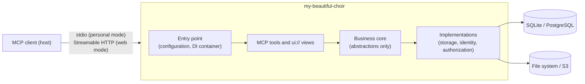

<!--
SPDX-FileCopyrightText: 2026 bobyone
SPDX-License-Identifier: GPL-2.0-or-later
-->

# Architecture

This document describes the architecture on three levels: overview,
abstractions and implementations. It is completed as each notion is
designed and implemented.

## Overview

my-beautiful-choir is an MCP server whose tools come with MCP Apps views
(`ui://` resources) rendered by the MCP client
([ADR 0002](decisions/0002-mcp-app-with-web-and-personal-modes.md)).

- **Entry point** (`cli.main`): reads the configuration once, configures
  the logs, assembles the application with `create_container(settings)` and
  runs it. It turns startup errors into a message and an exit code (see
  [troubleshooting](how-to/troubleshoot-startup.md)).
- **Assembly** (`containers`, `dependency-injector`): the only place where
  concrete implementations are chosen. `ApplicationContainer` holds the
  providers common to both modes; it receives, through a
  `DependenciesContainer` named `mode`, either `PersonalModeContainer` or
  `WebModeContainer`, which provide `metrics` and `transport`. Singletons
  are scoped to the container.
- **Business core**: tools and views (for now, `show_about`); repertoire and
  scores come next. It depends only on abstractions.
- **Implementations**: one set per mode, for identity, authorization
  ([ADR 0003](decisions/0003-multi-choir-tenancy-and-roles.md),
  [ADR 0004](decisions/0004-built-in-oauth-authorization-server.md)) and
  storage ([ADR 0005](decisions/0005-data-and-file-storage.md)).

## Notions

Each notion is a package of `src/my_beautiful_choir/`. Its general
abstraction sits at the root of the package; specializations and
implementations sit in sub-packages. Each notion defines its own exceptions
in `errors.py`; every exception derives from `MyBeautifulChoirError`.
Expected failures of an operation (element not found, invalid value) derive
from `DomainError`: their English message is returned to the model. Errors
preventing startup derive from `StartupError`, which carries a stable error
code and the process exit code.

## Abstractions

| Abstraction | Package | Role and contract |
|---|---|---|
| `Tool[ArgumentsT]` | `tools` | Operation offered to the MCP client, independent of the MCP SDK: `name`, `description` (English, for the model), `arguments_model` (pydantic model of the arguments, `NoArguments` when there is none; the MCP layer publishes its JSON Schema and validates the arguments), `view` (None by default), `async execute(arguments: ArgumentsT, context: ToolContext) -> ToolResult`; raises a `DomainError`. A tool asking for confirmation may run twice for one call (see `ElicitationConfirmation`): it changes nothing before asking. |
| `ViewTool[ArgumentsT](Tool)` | `tools.view_tool` | Tool displayed by a `View`. Template method: subclasses implement `_collect(arguments, context)` (data for the view) and `_describe(data)` (self-sufficient English text); `execute` returns both, so the text always matches the view. |
| `View` | `views` | User interface rendered by the client: `uri` (`ui://`), `content()` (self-contained HTML); raises `ViewNotFoundError`. |
| `ConfirmationRequester` | `confirmation` | `async ask(question) -> ConfirmationOutcome` (`confirmed`, `refused` or `unavailable` when the user cannot be asked); never raises because the user cannot be asked. |
| `Authorization` | `authorization` | `require(permission, choir_id=None)`: checks that the current user has a `Permission` (`manage_choirs`, `manage_repertoire`, `consult_repertoire`), in a choir when given ([ADR 0003](decisions/0003-multi-choir-tenancy-and-roles.md)); raises `AccessDeniedError`. |
| `Clock` | `clock` | `now() -> datetime`: current date and time, timezone-aware, in UTC. |
| `Metrics` | `monitoring` | `record_tool_call(tool_name, duration_seconds, failed)`, `record_http_request(method, route, status_code, duration_seconds)`, `export() -> MetricsExport`. |
| `HealthCheck` | `monitoring` | `status() -> HealthStatus` (`ready` or `unavailable`). |
| `Transport` | `transport` | `async run(server)`: serves an MCP SDK server until the client disconnects or a stop signal; raises a `StartupError` when it cannot start. |

Value objects: `Settings` and `WebSettings` (`configuration`, immutable),
`ApplicationInfo` (`application`: name, version, mode), `ToolResult`
(`tools`: `text`, `structured`), `ToolContext` (`tools`: `confirmation`, what
a tool can use during one call), `MetricsExport` (`monitoring`).

## Implementations

### `cli.main(argv=None) -> int`

Exit codes: 0 normal stop (including Ctrl+C), 1 unexpected error
(`MBC-UNEXPECTED`), 2 invalid configuration or usage (`MBC-CONFIG`), 3
unavailable resource (`MBC-PORT`), 4 incomplete installation
(`MBC-INSTALL`). Installed as the `my-beautiful-choir` command, and run by
`python -m my_beautiful_choir`.

### Containers (`containers`)

| Container | Provides | Depends on |
|---|---|---|
| `ApplicationContainer` | `application_info`, `views_directory`, `about_view`, `show_about_tool` (metered), `tools`, `server_builder`, `application` | `settings`, `mode` |
| `PersonalModeContainer` | `metrics` (`NullMetrics`), `transport` (`StdioTransport`) | `settings` |
| `WebModeContainer` | `metrics` (`PrometheusMetrics`), `health_check` (`ServerHealthCheck`), `transport` (`HttpTransport`) | `settings` |

`create_container(settings)` picks the mode container from `settings.mode`.
Tests replace a provider with `override()`, for instance
`container.mode.transport.override(...)`.

### `Application` (`application`)

`run()` builds the MCP server (failing at startup if a view is missing),
then serves it with the transport until it stops. Depends on
`ApplicationInfo`, `McpServerBuilder` and `Transport`.

### `load_settings(argv)` (`configuration.loader`)

Parses the command line (`--mode`, `--version`, `--help`), reads the `MBC_`
environment variables and returns validated, immutable `Settings`. Raises
`ConfigurationError` (`MBC-CONFIG`, exit code 2) listing every invalid key.
Only the entry point calls it. See the [configuration reference](configuration.md).

### `ShowAboutTool` (`tools.view_tool.about`)

`show_about`: no argument; returns the name, version and mode of the
application (`{"name", "version", "mode"}`) and the text
`"<name> <version>, <mode> mode."`. Depends on `ApplicationInfo` and its view.

### `MeteredTool` (`tools`)

Decorator of any `Tool`: delegates name, description, arguments model and view, and
records each call (duration, failure when an exception is raised) in the
injected `Metrics`. Exceptions are re-raised unchanged. A call suspended to
wait for the user (`ToolCallSuspended`) is not recorded: the retry is.

### `ElicitationConfirmation` (`confirmation.mcp`)

| Parameter | Type | Description |
|---|---|---|
| `context` | SDK `Context` | Request context of the current tool call. |

Asks the user through the MCP client (form elicitation with one checkbox,
checked by default):

1. if the call carries the answer (a retry), returns `confirmed` when the
   form was accepted with the box checked, `refused` otherwise;
2. if the client does not support elicitation, returns `unavailable`;
3. from protocol 2026-07-28, raises `ConfirmationInputRequired`: the MCP
   layer ends the call with an input request, and the client retries it
   with the answer;
4. before, asks during the call; a client error gives `unavailable`.

**Limit:** the question is in English: the server does not know the
user's language.

### `PackagedView` (`views.packaged`)

| Parameter | Type | Description |
|---|---|---|
| `name` | `str` | File name without extension; the URI is `ui://my-beautiful-choir/<name>.html`. |
| `directory` | `Traversable` | Directory of the built views; `packaged_views_directory()` returns `my_beautiful_choir/views/static/` in the installed package. |

Reads `<name>.html` on first use and keeps it in memory. A missing file
raises `ViewNotFoundError` (`MBC-INSTALL`, exit code 4): the user interface
was not built (`uv run nox -s ui`) or the installation is broken.

### `McpServerBuilder` (`mcp`)

Adapter between our tools and views and the MCP SDK (`MCPServer` and its
`Apps` extension). With the MCP adapters of other notions (`*/mcp/`), the
only code that imports the SDK.

| Parameter | Type | Description |
|---|---|---|
| `application_info` | `ApplicationInfo` | Name and version announced to the client. |
| `tools` | `Sequence[Tool]` | Tools to publish. |

`build()` returns a new `MCPServer`:

- a tool with a view is registered through MCP Apps (`_meta.ui.resourceUri`),
  and its view as a `ui://` resource (`text/html;profile=mcp-app`), once
  per URI; a tool without a view is a plain tool;
- the function registered for each tool gets a signature generated from the
  tool's arguments model (types, constraints, descriptions, defaults and
  default factories), so that the SDK publishes the JSON Schema and
  validates the arguments;
- arguments rejected by the model itself (for instance by a model
  validator) are returned to the model as an error result with the
  validation message;
- each call receives a `ToolContext` whose confirmation is an
  `ElicitationConfirmation` on the SDK request context, passed through a
  reserved parameter (`mbc_request_context`, refused as an argument name);
- a `ConfirmationInputRequired` ends the call with its input request;
- a `DomainError` is returned to the model as an error result with its
  message; any other exception is logged with its stack trace and
  returned as a generic error, without technical details;
- a missing view raises `ViewNotFoundError` during the build, hence at
  startup.

### `StdioTransport` (`transport.stdio`)

Serves MCP on stdin and stdout until stdin is closed. No parameter.

### `HttpTransport` (`transport.http`)

| Parameter | Type | Description |
|---|---|---|
| `settings` | `WebSettings` | Listening address, port and allowed hosts. |
| `metrics` | `Metrics` | Receives the HTTP request measures; exported on `/metrics`. |
| `health_check` | `ServerHealthCheck` | Marked ready once listening, unavailable when stopping. |

Routes: `/mcp` (Streamable HTTP, stateful sessions in memory), `/healthz`
(200 `{"status": "ready"}`, or 503 `{"status": "unavailable"}`), `/metrics`.

- **DNS rebinding protection** is always on: the `Host` header must be a
  local host (`127.0.0.1`, `localhost`, `[::1]`, any port) or one of
  `MBC_WEB__ALLOWED_HOSTS`; otherwise `/mcp` answers 421.
- **Correlation id**: `X-Request-ID` is reused when it is a valid UUID,
  generated otherwise, returned in the response and added to every log
  record of the request.
- **Request log**: one record per request with method, route, status and
  duration; never the client address. Unknown paths are grouped under the
  `other` route.
- The listening socket is opened before uvicorn starts: an address in use
  raises `PortUnavailableError` (`MBC-PORT`, exit code 3).
- `request_stop()` stops the server gracefully, like a stop signal. A
  SIGTERM (`docker stop`) stops it gracefully too, and the process then exits
  with code 0; uvicorn would otherwise raise SIGTERM again after the shutdown.
- **Limit**: no authentication yet; web mode must not be exposed publicly
  until OAuth is implemented.

### User interface (`ui/`)

Each view is a React application built by Vite into one self-contained HTML
file (`vite-plugin-singlefile`): MCP hosts render it in a sandboxed iframe
that forbids remote resources. Views are copied into
`my_beautiful_choir/views/static/` and served by `PackagedView`.

| Module | Role |
|---|---|
| `src/host/useHost.ts` | Connects the view to the host (`useApp`), keeps the tool result and the host context (merged with its changes), applies the host styles (`useHostStyles`). |
| `src/i18n/catalogues.ts` | Loads every catalogue of `ui/locales/` and the fallbacks of `ui/i18n/fallbacks.json`. |
| `src/i18n/resolveLanguage.ts` | Chooses the catalogue for the host locale: full tag, language and script, language, each with its fallback; English otherwise. |
| `src/i18n/i18n.ts` | Creates the i18next instance with ICU messages and English as fallback. |
| `src/theme/applyTheme.ts` | Applies the host theme to Bootstrap (`data-bs-theme`), light by default. |
| `src/views/about/` | The "About" view: `AboutApp` (host, language, theme), `AboutView` (loading, error, connection error, information), `parseAboutInfo` (validates the `show_about` structured content). |

Every user-facing text goes through a translation key; labels of glossary
terms use the `glossary.*` keys. See
[how to add a language](how-to/add-a-language.md) and
[how to build the user interface](how-to/build-the-ui.md).

### `LocalUserAuthorization` (`authorization.local`)

Personal mode: the implicit user manages every choir, so every permission
is granted. No parameter.

### `SystemClock` (`clock`)

Reads the system clock, in UTC. No parameter.

### `NullMetrics` (`monitoring`)

Null Object used in personal mode: records nothing, exports an empty body.

### `PrometheusMetrics` (`monitoring.prometheus`)

| Parameter | Type | Default | Description |
|---|---|---|---|
| `registry` | `CollectorRegistry \| None` | new registry | Prometheus registry holding the series. |

Series: `mbc_tool_calls_total{tool, outcome}`,
`mbc_tool_call_duration_seconds{tool}`,
`mbc_http_requests_total{method, route, status}`,
`mbc_http_request_duration_seconds{method, route}`. Export in the Prometheus
text format. HTTP routes are templates, never raw paths, to bound the number
of series.

### `ServerHealthCheck` (`monitoring.server`)

`unavailable` until `mark_ready()` is called once the server listens;
`mark_unavailable()` when shutting down.

### `configure_logging(level, stream=stderr)` (`monitoring.logging_setup`)

One JSON object per line on stderr (never stdout: in personal mode it
carries the MCP protocol), with `timestamp`, `level`, `logger`, `message`,
`correlation_id` (null outside an HTTP request) and any `extra` field.
Library loggers (`uvicorn`, `mcp`) go through the same handler. The uvicorn
access log is disabled because it holds client IP addresses.
