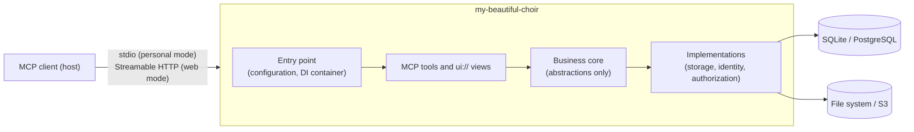

<!--
SPDX-FileCopyrightText: 2026 bobyone
SPDX-License-Identifier: GPL-2.0-or-later
-->

# Architecture

This document describes the architecture on three levels: overview,
abstractions and implementations. It is completed as each notion is
designed and implemented.

## Overview

my-beautiful-choir is an MCP server whose tools come with MCP Apps views
(`ui://` resources) rendered by the MCP client
([ADR 0002](decisions/0002-mcp-app-with-web-and-personal-modes.md)).

- **Entry point**: reads the configuration once, selects the mode, builds
  the dependency injection container (`dependency-injector`) and starts the
  transport. It is the only place where concrete implementations are
  chosen.
- **Business core**: repertoire and scores; depends only on abstractions.
- **Implementations**: one set per mode, for identity, authorization
  ([ADR 0003](decisions/0003-multi-choir-tenancy-and-roles.md),
  [ADR 0004](decisions/0004-built-in-oauth-authorization-server.md)) and
  storage ([ADR 0005](decisions/0005-data-and-file-storage.md)).

## Notions

Each notion is a package of `src/my_beautiful_choir/`. Its general
abstraction sits at the root of the package; specializations and
implementations sit in sub-packages. Each notion defines its own exceptions
in `errors.py`; every exception derives from `MyBeautifulChoirError`, and
errors preventing startup derive from `StartupError`, which carries a stable
error code and the process exit code.

## Abstractions

| Abstraction | Package | Role and contract |
|---|---|---|
| `Tool[ArgumentsT]` | `tools` | Operation offered to the MCP client, independent of the MCP SDK: `name`, `description` (English, for the model), `arguments_model` (pydantic model of the arguments, `NoArguments` when there is none; the MCP layer publishes its JSON Schema and validates the arguments), `view` (None by default), `async execute(arguments: ArgumentsT) -> ToolResult`; raises `ToolExecutionError`. |
| `ViewTool[ArgumentsT](Tool)` | `tools.view_tool` | Tool displayed by a `View`. Template method: subclasses implement `_collect(arguments)` (data for the view) and `_describe(data)` (self-sufficient English text); `execute` returns both, so the text always matches the view. |
| `View` | `views` | User interface rendered by the client: `uri` (`ui://`), `content()` (self-contained HTML); raises `ViewNotFoundError`. |
| `Metrics` | `monitoring` | `record_tool_call(tool_name, duration_seconds, failed)`, `record_http_request(method, route, status_code, duration_seconds)`, `export() -> MetricsExport`. |
| `HealthCheck` | `monitoring` | `status() -> HealthStatus` (`ready` or `unavailable`). |

Value objects: `Settings` and `WebSettings` (`configuration`, immutable),
`ApplicationInfo` (`application`: name, version, mode), `ToolResult`
(`tools`: `text`, `structured`), `MetricsExport` (`monitoring`).

## Implementations

### `load_settings(argv)` (`configuration.loader`)

Parses the command line (`--mode`, `--version`, `--help`), reads the `MBC_`
environment variables and returns validated, immutable `Settings`. Raises
`ConfigurationError` (`MBC-CONFIG`, exit code 2) listing every invalid key.
Only the entry point calls it. See the [configuration reference](configuration.md).

### `ShowAboutTool` (`tools.view_tool.about`)

`show_about`: no argument; returns the name, version and mode of the
application (`{"name", "version", "mode"}`) and the text
`"<name> <version>, <mode> mode."`. Depends on `ApplicationInfo` and its view.

### `MeteredTool` (`tools`)

Decorator of any `Tool`: delegates name, description, arguments model and view, and
records each call (duration, failure when an exception is raised) in the
injected `Metrics`. Exceptions are re-raised unchanged.

### `PackagedView` (`views.packaged`)

| Parameter | Type | Description |
|---|---|---|
| `name` | `str` | File name without extension; the URI is `ui://my-beautiful-choir/<name>.html`. |
| `directory` | `Traversable` | Directory of the built views; `packaged_views_directory()` returns `my_beautiful_choir/views/static/` in the installed package. |

Reads `<name>.html` on first use and keeps it in memory. A missing file
raises `ViewNotFoundError` (`MBC-INSTALL`, exit code 4): the user interface
was not built (`uv run nox -s ui`) or the installation is broken.

### `NullMetrics` (`monitoring`)

Null Object used in personal mode: records nothing, exports an empty body.

### `PrometheusMetrics` (`monitoring.prometheus`)

| Parameter | Type | Default | Description |
|---|---|---|---|
| `registry` | `CollectorRegistry \| None` | new registry | Prometheus registry holding the series. |

Series: `mbc_tool_calls_total{tool, outcome}`,
`mbc_tool_call_duration_seconds{tool}`,
`mbc_http_requests_total{method, route, status}`,
`mbc_http_request_duration_seconds{method, route}`. Export in the Prometheus
text format. HTTP routes are templates, never raw paths, to bound the number
of series.

### `ServerHealthCheck` (`monitoring.server`)

`unavailable` until `mark_ready()` is called once the server listens;
`mark_unavailable()` when shutting down.

### `configure_logging(level, stream=stderr)` (`monitoring.logging_setup`)

One JSON object per line on stderr (never stdout: in personal mode it
carries the MCP protocol), with `timestamp`, `level`, `logger`, `message`,
`correlation_id` (null outside an HTTP request) and any `extra` field.
Library loggers (`uvicorn`, `mcp`) go through the same handler. The uvicorn
access log is disabled because it holds client IP addresses.
