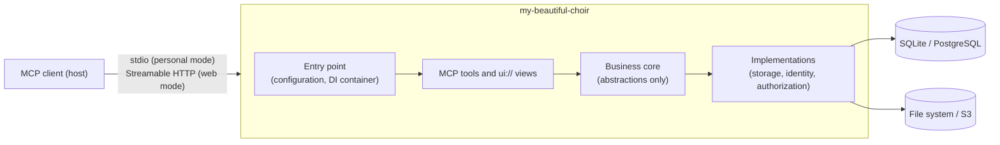

<!--
SPDX-FileCopyrightText: 2026 bobyone
SPDX-License-Identifier: GPL-2.0-or-later
-->

# Architecture

This document describes the architecture on three levels: overview,
abstractions and implementations. It is completed as each notion is
designed and implemented.

## Overview

my-beautiful-choir is an MCP server whose tools come with MCP Apps views
(`ui://` resources) rendered by the MCP client
([ADR 0002](decisions/0002-mcp-app-with-web-and-personal-modes.md)).

- **Entry point**: reads the configuration once, selects the mode, builds
  the dependency injection container (`dependency-injector`) and starts the
  transport. It is the only place where concrete implementations are
  chosen.
- **Business core**: repertoire and scores; depends only on abstractions.
- **Implementations**: one set per mode, for identity, authorization
  ([ADR 0003](decisions/0003-multi-choir-tenancy-and-roles.md),
  [ADR 0004](decisions/0004-built-in-oauth-authorization-server.md)) and
  storage ([ADR 0005](decisions/0005-data-and-file-storage.md)).

## Abstractions

To be documented with the application skeleton.

## Implementations

To be documented with the application skeleton.
